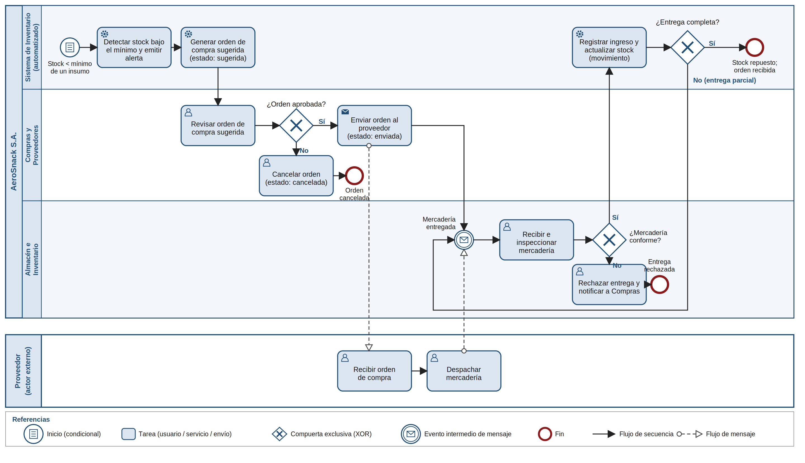

# Modelado BPMN: reposición de insumos

Proceso de negocio que el **Módulo de Gestión de Inventario y Trazabilidad de Stock** de AeroSnack S.A. automatiza y transforma:
hoy el almacén controla el stock de forma manual y de manera reactiva; con el módulo, la reposición se dispara sola cuando un
insumo cae por debajo de su umbral mínimo.

- Imagen: [`bpmn_reposicion_insumos.png`](bpmn_reposicion_insumos.png)
- Vectorial editable: [`bpmn_reposicion_insumos.svg`](bpmn_reposicion_insumos.svg)

> **Alcance y supuestos.** AeroSnack S.A. es una empresa ficticia. El proceso es un supuesto de diseño derivado de las Entregas 1 a 3
> y no fue validado con usuarios reales.

## Notación

Se utiliza BPMN 2.0:

- **Pools:** organizaciones y actores externos. `AeroSnack S.A.` es el pool principal; `Proveedor` es un actor externo (caja negra, solo se modelan sus interacciones).
- **Lanes:** roles internos y comportamiento automatizado. Coinciden con las unidades del organigrama de la Entrega 3.
- **Compuertas exclusivas (XOR):** modelan las excepciones del proceso.
- **Flujos de secuencia** (línea continua) dentro de un pool y **flujos de mensaje** (línea punteada) entre pools.

## Participantes

| Pool / Lane | Unidad del organigrama (Entrega 3) | Rol en el proceso |
|---|---|---|
| Sistema de Inventario (automatizado) | Área de Sistemas (módulo) | Detecta el stock bajo, genera la orden sugerida y registra el ingreso |
| Compras y Proveedores | Departamento de Compras y Proveedores | Revisa, aprueba o cancela, y envía la orden |
| Almacén e Inventario | Departamento de Almacén e Inventario | Recibe e inspecciona la mercadería |
| Proveedor (pool externo) | Proveedores agrícolas y de insumos (entorno, Entrega 1) | Recibe la orden y despacha la mercadería |

## Flujo estándar

1. **Inicio condicional:** `stock_actual` de un insumo queda por debajo de su `stock_minimo`.
2. El sistema **detecta el faltante y emite la alerta**.
3. El sistema **genera la orden de compra sugerida** (`estado = sugerida`, `es_automatica = true`).
4. Compras **revisa la orden**.
5. Compuerta **¿orden aprobada?** Si es afirmativo, la orden pasa a `aprobada` y Compras la **envía al proveedor** (`estado = enviada`).
6. El proveedor **recibe la orden** y **despacha la mercadería** (flujos de mensaje).
7. Evento de mensaje **mercadería entregada** en el almacén.
8. Almacén **recibe e inspecciona** la mercadería.
9. Compuerta **¿mercadería conforme?** Si es afirmativo, el sistema **registra el movimiento de ingreso** (vinculado a `id_orden`) y **actualiza `stock_actual`**.
10. Compuerta **¿entrega completa?** Si es afirmativo, la orden pasa a `recibida` y el proceso termina con el stock repuesto.

## Excepciones (compuertas de decisión)

| Compuerta | Rama de excepción | Resultado | Dato afectado |
|---|---|---|---|
| ¿Orden aprobada? | No | Compras cancela la orden y el proceso termina | `ORDEN_COMPRA.estado = cancelada` |
| ¿Mercadería conforme? | No | Almacén rechaza la entrega y notifica a Compras; el proceso termina | No se registra ingreso en `MOVIMIENTO_STOCK` |
| ¿Entrega completa? | No (entrega parcial) | Se registra el ingreso parcial y el proceso vuelve a esperar la próxima entrega | Un `MOVIMIENTO_STOCK` por entrega; la orden sigue abierta |

La rama de entrega parcial se apoya en la relación *Orden de Compra – Movimiento de Stock (1 a N)* del diccionario de datos de la Entrega 3.

## Límites de esta versión

- Tras una **entrega rechazada**, el reclamo al proveedor y la emisión de una nueva orden no están modelados; se tratarían como una extensión del proceso.
- No se modelan plazos de entrega del proveedor ni su cumplimiento.

## Trazabilidad con otros artefactos

| Elemento del BPMN | Artefacto relacionado |
|---|---|
| Alerta y orden sugerida | Historia de usuario HU-02, meta M4 |
| Registro de ingreso y actualización de stock | Historia de usuario HU-01, metas M1 y M2 |
| Estados de la orden | Campo `estado` de `ORDEN_COMPRA` (Entrega 3, Tabla 7) |
